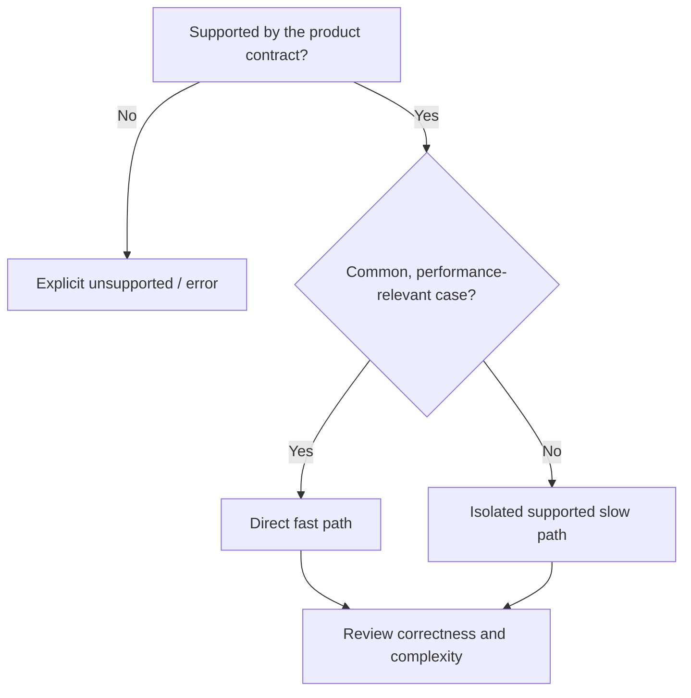

# ESP-0024: Minimal sufficient implementation complexity

> - **Status:** Proposed
> - **Normative:** No
> - **Integration targets:** New required `core/implementation-simplicity` Specification and a new Catalog version.

## Summary

Add a cross-language, implementation-time Core Specification that favors the
least complexity needed for actual business requirements. Specify supported
inputs before extending algorithms, keep common execution paths direct, reject
unsupported cases explicitly, trust established internal contracts, and
introduce abstractions and performance mechanisms only for demonstrated value.

## Motivation

Code generation and review can add branches, redundant validation, one-use
helpers, fallback chains, and generic frameworks in anticipation of scenarios a
product does not support. These additions increase reading and maintenance
cost while introducing failure states that ordinary requests must traverse.
This is a general implementation concern, not a naming rule, language idiom,
or data-boundary rule.

## Scope and non-goals

Applies to designing, implementing, modifying, and reviewing application code,
tests, and relevant configuration. The engineer or agent evaluates supported
usage, call sites, representative data, and existing contracts before choosing
an implementation.

It does **not**:
- suppress necessary security, data-integrity, safety, or external-input checks;
- override externally guaranteed API behavior, compatibility promises, or
  explicitly required tolerance and fallback;
- ban all helpers, reuse, defensive checks, error handling, or slow paths;
- impose numeric limits on function size, branches, test cases, or performance;
- require benchmarking for a straightforward correctness fix;
- dictate language syntax or framework architecture.

## Proposed behavior

The normative integration should cover eight independent decisions:

1. **SIM-SCOPE-001** — Identify real supported cases and avoid speculative
   features; state non-supported input and behavior boundaries.
2. **SIM-PATH-001** — Keep the common path simple; isolate lower-frequency
   complex but genuinely supported behavior.
3. **SIM-FAIL-001** — Fail explicitly for unsupported or invalid inputs rather
   than guessing, self-repairing, or cascading through undocumented fallbacks.
4. **SIM-CHECK-001** — Validate at trust and effect boundaries, without
   repeating checks already guaranteed by an enforced upstream contract.
5. **SIM-ABSTRACT-001** — Require a meaningful semantic or reuse benefit before
   adding wrappers, helpers, polymorphism, generic frameworks, or configuration.
6. **SIM-READ-001** — Keep local flow intelligible and minimize hidden states,
   branches, and context jumps.
7. **SIM-PERF-001** — Drive complex optimizations from representative workloads
   and measurements; prefer direct bottleneck relief for common paths.
8. **SIM-CHANGE-001** — Limit changes to the affected behavior and review
   removable branches, validations, wrappers, and unused functionality.

The implementation decision order is: satisfy the supported business
requirement, preserve correctness and security, make the common path direct,
keep code maintainable, abstract for actual reuse, and support rare cases only
when their value justifies the cost. Unsupported inputs fail explicitly.

## Composition and routing impact

- New ID: `core/implementation-simplicity`, independent of the existing
  `core/semantic-naming` and `core/data-boundaries`.
- **Required:** available in each implementation repository; task-time activation
  limited to code design, implementation, modification, or review.
- Candidate scopes: `**/*`; the task-intent Applicability contract prevents
  blanket reading for unrelated docs, audits, or operational tasks.
- Catalog description: `Load when designing, implementing, refactoring, or
  reviewing code complexity, common paths, validation, abstractions, or performance`.
- No change to existing Spec dependency graph, Catalog schema, RF defaults,
  selection semantics, or automated-enforcement machinery.

## Compatibility and maturity

The new Spec starts at Development `0.1.0` with eight Advisory Requirements.
Adding a required Spec expands the contract for consuming projects, so prepare
a new development Catalog `1.8.0` rather than rewriting the already-integrated
`1.7.1` identity. Existing consumers remain pinned until they explicitly
upgrade. Any production release requires separate immutable-tag publication.
No existing Requirement IDs or interpretations are changed.

## Failure modes and corner cases

An explicit resilience requirement, legacy wire format, security boundary, or
formal availability target may justify validation or fallback that would
otherwise be redundant. In such cases the owning contract prevails and the
review records why the additional complexity is necessary. A rare case that is
actually supported should remain correct, even when isolated from the fast path.

## Trade-offs and mitigations

A qualitative simplicity rule can be misused to skip required behavior or
security checks. Keep enforcement Advisory, base review on the repository's
actual contracts and evidence, and explicitly distinguish unsupported cases
from rare supported cases. Avoid numerical complexity scores and new linters:
the affected code and contract review are the evidence.

## Prior art and alternatives

- **Add prose to `core/semantic-naming` or `core/data-boundaries`:** rejected;
  those Specs own different contracts and would create unrelated activation.
- **Add an optional language-specific guide:** rejected because the behavior is
  cross-language and intended to govern routine implementation work.
- **Keep it only in Agent instructions:** rejected because instructions lack the
  versioned Requirement IDs, verification, and reusable cross-project contract
  expected from this repository.
- **Prescribe a universal fast-path template or complexity thresholds:** rejected;
  business workload and language constraints determine useful structure.

## Prototypes and evidence

The first integration is a normative review contract, not a claim of measured
speedup. Validate Catalog digests, metadata, Requirement closure, and precise
Verification coverage using the existing canonical check. Review two
illustrative cases: a required strict parser that fails fast on unsupported
input, and a service whose measured common path avoids an expensive rare-case
fallback. No consumer implementation is modified by this proposal.

## Open questions

Should the new Required Spec apply to **all** implementation repositories
(default proposed here), or should it be explicitly selected? This changes
automatic adoption and must be settled in proposal review before integration.

## Integration plan

After approval, create a **separate normative integration PR** that adds
`specification/core/implementation-simplicity.md`, updates Catalog metadata
and digest, extends the Spec index and relevant README, updates the Changelog,
and adapts exact Catalog regression expectations. Run
`python3 -B scripts/check.py` and the RF compatibility workflow.
